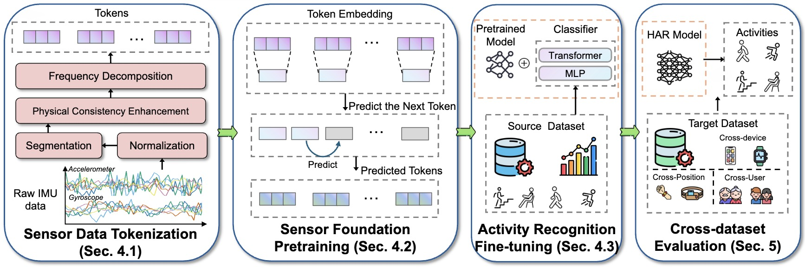
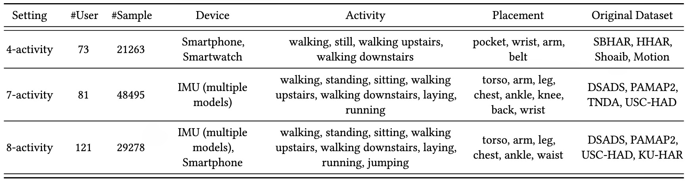

# Next Token Prediction for Generalizable Human Activity Recognition [CIKM 2026]

This repository provides the official implementation for our paper “**Next Token Prediction for Generalizable Human Activity Recognition**”, accepted by the *ACM Conference on Knowledge and Information Management (CIKM 2026)*. In this work, we introduce NextHAR, a novel next-token prediction pretraining paradigm for Inertial Measurement Unit (IMU) sensor–based Human Activity Recognition (HAR), and establish a large-scale cross-domain benchmark covering up to eight activity categories.

<!---

-->

## Requirement
To install the required dependencies, please run:
```shell
pip install -r requirements.txt
```

## Benchmark

We construct a comprehensive cross-domain benchmark designed to evaluate the generalization capability of sensor-based HAR models.
The benchmark comprises three evaluation settings with increasing difficulty levels, utilizing nine widely used HAR datasets:
SBHAR, HHAR, Shoaib, Motion, DSADS, PAMAP2, TNDA, USC-HAD, and KU-HAR.

These datasets are selected for their overlapping activity classes and diverse characteristics, such as user variation, sensor types, and device placement.
Each evaluation setting includes four datasets, ensuring substantial heterogeneity for robust generalization assessment.

You can download the cross-dataset benchmark at [here](https://zenodo.org/records/17498195).



## Framework of NextHAR

The NextHAR framework consists of four major stages:

- Sensor Data Tokenization – Convert sensor data into expressive token representations.
- Sensor Token Pretraining – Conduct autoregressive pretraining based on the next token prediction objective specifically designed for sensor data.
- Activity Recognition Fine-Tuning – Fine-tune the pretrained model on a small number of labeled samples from a source dataset.
- Cross-Dataset Evaluation – Evaluate cross-dataset generalization capability on the proposed benchmark.

### Pretraining

```shell
# 4-activity setting
python pretrain.py --data_dir ./benchmark/4_activity --n_class 4 -d SBHAR

# 7-activity setting
python pretrain.py --data_dir ./benchmark/7_activity --n_class 7 -d DSADS

# 8-activity setting
python pretrain.py --data_dir ./benchmark/8_activity --n_class 8 -d KU-HAR
```

### Fine-tuning
```shell
# 4-activity setting
python finetune.py --data_dir ./benchmark/4_activity --n_class 4 -d SBHAR

# 7-activity setting
python finetune.py --data_dir ./benchmark/7_activity --n_class 7 -d DSADS

# 8-activity setting
python finetune.py --data_dir ./benchmark/8_activity --n_class 8 -d KU-HAR
```

### Cross-dataset Evaluation

```shell
# 4-activity
python cross_dataset_test.py --data_dir ./benchmark/4_activity --n_class 4 -d SBHAR -td HHAR

# 7-activity
python cross_dataset_test.py --data_dir ./benchmark/7_activity --n_class 7 -d DSADS -td PAMAP2

# 8-activity
python cross_dataset_test.py --data_dir ./benchmark/8_activity --n_class 8 -d KU-HAR -td DSADS
```
